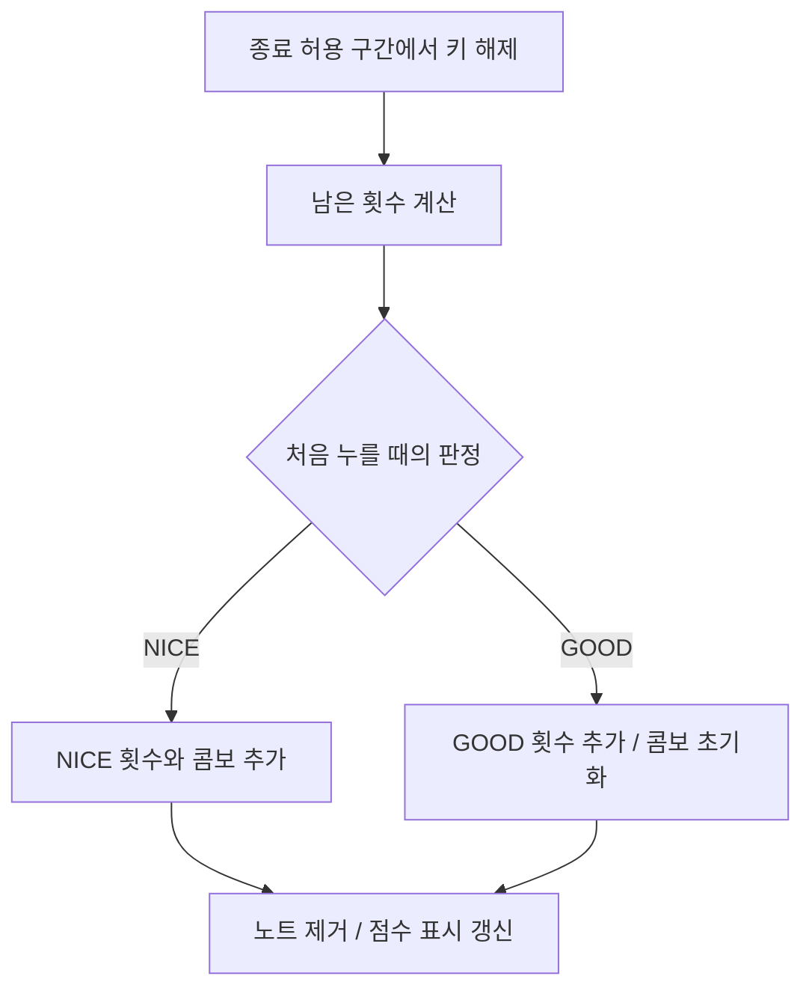
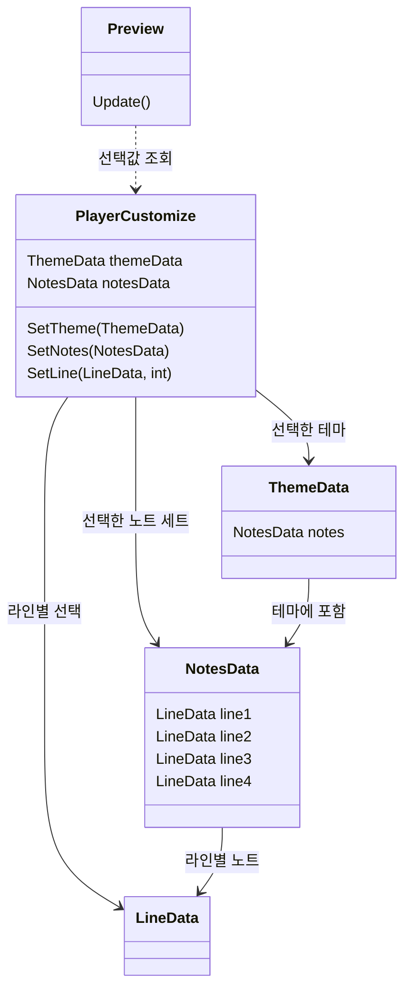

# 리듬게임 프로젝트

> **포트폴리오 공개 안내**  
> 저작권 문제를 고려하여 포트폴리오에 사용되는 사진과 영상은 사용 가능한 대체 리소스로 교체했습니다. 따라서 실제 개발 당시 사용한 자료와 일부 차이가 있을 수 있습니다.

스텔라이브를 주제로 제작한 **비공식 팬게임**입니다. 일반 모드와 댄스 모드를 지원하며, 테마와 개별 설정으로 플레이 화면을 꾸밀 수 있습니다.

Unity로 만든 첫 대형프로젝트입니다.

| 항목 | 내용 |
|---|---|
| 개발 형태 | 개인 프로젝트 |
| 사용 기술 | Unity / C# / FMOD / ScriptableObject / JSON |

[LHEALP/UnityRhythmGame](https://github.com/LHEALP/UnityRhythmGame)을 기반으로 학습하며 개발했습니다. 시간 기반 판정 / 노트 이동과 위치 보정 / 풀링 / 채보 에디터의 기존 구조를 활용했습니다.

## 플레이 영상

추가 예정

## 목차

- [핵심 기술](#핵심-기술)
  - [1. 롱노트 점수 처리](#1-롱노트-점수-처리)
    - [종료 처리](#종료-처리)
  - [2. FMOD 연동](#2-fmod-연동)
    - [판정과 노트 위치](#판정과-노트-위치)
    - [배경 영상](#배경-영상)
  - [3. 커스터마이징](#3-커스터마이징)
    - [데이터 구조](#데이터-구조)
  - [4. 플레이 기록 저장](#4-플레이-기록-저장)
- [개선할 점](#개선할-점)
- [참고 자료](#참고-자료)

## 핵심 기술

### 1. 롱노트 점수 처리

참고한 프로젝트는 롱노트를 누를 때와 뗄 때 점수를 반영했습니다. 그러나 다른 리듬게임들은 보통 누르는 동안에도 콤보와 점수가 상승합니다.

누르고 있는 동안에도 점수와 콤보가 증가하도록 BPM에 맞춰 반복 실행하는 코루틴을 추가했습니다.

그런데 끝까지 눌렀을 때와 끝나기 조금 전에 손을 뗐을 때 점수가 달라지는 문제가 생겼습니다. 정상적으로 처리되는 범위에서 손을 떼더라도, 코루틴이 실행된 횟수가 적으면 점수와 콤보가 낮았습니다.

종료 허용 구간에서 손을 떼면 남은 판정 횟수를 반영하도록 수정했습니다. NICE로 시작한 롱노트는 이 구간에서 손을 떼면 끝까지 눌렀을 때와 같은 점수와 콤보를 얻도록 했습니다.

#### 종료 처리

처음 누를 때의 판정을 저장해 유지 중 점수 계산에 사용합니다. 손을 뗐을 때 종료까지 남은 시간이 0ms 이상 150ms 미만이면, 저장한 판정에 따라 남은 횟수를 반영합니다.



아래는 [Judgement.cs](Scripts/Gameplay/Vertical/Judgement.cs)의 `CheckLongNote()`에서 남은 횟수를 세고 반영하는 부분입니다. 코루틴이 점수를 반영할 때마다 `longTimeCountStart`를 다음 처리 시각으로 옮겨 두므로, 이 시각부터 롱노트 종료 시각인 `longTimeCount`까지 남은 횟수를 셉니다.

```csharp
while (longTimeCountStart[line] < longTimeCount[line])
{
    longComboCount[line] += 1;
    longTimeCountStart[line] += waitTime * 1000f;
}

if (longJudge[line] == JudgeType.NICE)
{
    score.data.nice += longComboCount[line];
    score.data.combo += longComboCount[line];
}
else
{
    score.data.good += longComboCount[line];
    score.data.combo = 0;
}
```

`waitTime`은 채보의 BPM과 마디 설정에 따라 정한 점수 처리 간격으로, 단위는 초입니다. NICE 한 번당 500점과 콤보 1개를 반영합니다.

종료 시각보다 150ms를 초과해 일찍 떼면 MISS로 처리합니다. 테스트할 때는 곡 초반에 짧은 / 중간 / 긴 롱노트를 배치하고, 끝까지 누르거나 조금 일찍 떼면서 점수와 콤보를 확인했습니다.

**관련 코드**

- 롱노트 판정: [Scripts/Gameplay/Vertical/Judgement.cs](Scripts/Gameplay/Vertical/Judgement.cs)
- 댄스 모드 판정: [Scripts/Gameplay/Dance/DanceJudgement.cs](Scripts/Gameplay/Dance/DanceJudgement.cs)
- 점수 계산: [Scripts/Gameplay/Common/Score.cs](Scripts/Gameplay/Common/Score.cs)

---

### 2. FMOD 연동

개발 중 AudioSource를 활용할 경우 같은 곡을 반복해서 플레이할 때 판정 타이밍이 다르게 느껴졌습니다. 이는 리듬게임에 있어서 치명적 문제라 생각했고, 다른 재생 방법을 찾아보다 FMOD를 적용했습니다.

음악 재생과 판정에 사용하는 시간을 FMOD 채널의 재생 위치로 변경했습니다. 적용 후 직접 플레이했을 때 타이밍이 나아졌다고 느꼈습니다.

#### 판정과 노트 위치

[MusicPlayer.cs](Scripts/Audio/MusicPlayer.cs)의 `GetMilliSec()`로 음악의 재생 위치를 읽습니다. 사용자 싱크 설정을 반영한 뒤 노트 시각과 비교해 판정합니다.

$$
\text{판정 오차} = \text{음악 재생 시간} - \text{싱크 보정값} - \text{노트 예정 시간}
$$

시간 단위는 ms입니다. 오차의 절댓값이 75ms 미만이면 NICE, 75ms 이상 150ms 미만이면 GOOD으로 판정합니다.

화면의 노트는 `Time.deltaTime`으로 이동시키고, 노트 생성이나 배속 변경 시 음악 시간에 맞춰 위치를 다시 계산합니다. 이때 노트 시각과 음악 시간의 차이에 싱크 설정과 배속을 반영해 판정선으로부터의 거리를 구합니다.

노트의 이동과 판정은 각각 처리하지만, 같은 음악 시간을 기준으로 동작합니다. 이 구조는 참고 프로젝트를 활용했고, 음악 재생과 시간 조회 부분을 FMOD에 연결했습니다.

#### 배경 영상

음악 파일과 영상 파일을 분리해 FMOD와 VideoPlayer로 재생합니다. 영상의 오디오는 끄고, 재생 / 일시정지 / 재개를 함께 처리했습니다. 재생 위치를 설정할 때는 ms를 초로 변환해 영상에도 반영합니다.

**관련 코드**

- 음악과 영상 재생: [Scripts/Audio/MusicPlayer.cs](Scripts/Audio/MusicPlayer.cs)
- 노트 이동과 위치 보정: [Scripts/Gameplay/Vertical/NoteObject.cs](Scripts/Gameplay/Vertical/NoteObject.cs)
- 노트 생성: [Scripts/Gameplay/Vertical/NoteGenerator.cs](Scripts/Gameplay/Vertical/NoteGenerator.cs)

---

### 3. 커스터마이징

개인적으로 노트 각 라인 하나씩 커스터마이징 가능한 것을 좋아하지만, 간단하게 설정을 끝내고 싶은 사용자도 있을 것이라 생각했습니다. 기본적으로 테마를 한 번에 적용할 수 있도록 하고, 상세 설정을 켜면 각 요소를 따로 바꿀 수 있게 만들었습니다.

| 설정 | 적용 대상 |
|---|---|
| 테마 | 기어 / 노트 세트 / 캐릭터 / 판정선 / 타격 이펙트 |
| 노트 세트 | 네 라인의 노트 조합 |
| 개별 설정 | 기어 / 라인별 노트 / 캐릭터 / 판정선 / 이펙트 / 타격음 등 |

#### 데이터 구조

테마와 노트 세트는 ScriptableObject로 만들었습니다. `PlayerCustomize`가 선택한 데이터를 보관하며, 테마 선택과 개별 설정 모두 이 값을 변경합니다.



화면 왼쪽에는 움직이는 노트와 기어 미리보기를 배치했습니다. [Preview.cs](Scripts/Customize/Preview/Preview.cs)의 `Update()`에서 선택값을 읽어 이미지와 색상을 갱신하므로, 플레이에 들어가기 전에 설정 결과를 확인할 수 있습니다.

**관련 코드**

- 선택값 관리: [Scripts/Customize/PlayerCustomize.cs](Scripts/Customize/PlayerCustomize.cs)
- 설정 화면: [Scripts/Customize/CustomManager.cs](Scripts/Customize/CustomManager.cs)
- 테마 데이터: [Scripts/Customize/Data/ThemeData.cs](Scripts/Customize/Data/ThemeData.cs)
- 노트 세트 데이터: [Scripts/Customize/Data/NotesData.cs](Scripts/Customize/Data/NotesData.cs)
- 미리보기: [Scripts/Customize/Preview/Preview.cs](Scripts/Customize/Preview/Preview.cs)

---

### 4. 플레이 기록 저장

처음에는 곡과 난이도별 결과를 PlayerPrefs의 문자열로 저장하려 했습니다. 모드와 기록 항목이 늘어나면 관리하기 어려울 것 같아 `PlayRecord`로 데이터를 묶고 JSON 파일에 저장하도록 구성했습니다.

기록은 `songId / difficulty / gameMode` 조합으로 구분합니다. 최고 점수 / 최대 콤보 / 최고 정확도는 항목별로 갱신하며, 새 기록이나 갱신된 값이 있을 때 `RecordRepository`가 `records.json`에 저장합니다.

자연스럽게 댄스 모드에도 같은 데이터 구조를 사용하게 됩니다. 음량과 커스터마이징 선택값 같은 간단한 설정은 PlayerPrefs에 저장합니다. JSON 저장을 구현할 때는 ChatGPT의 도움을 받았습니다.

**관련 코드**

- 기록 데이터: [Scripts/Records/PlayRecord.cs](Scripts/Records/PlayRecord.cs)
- 기록 조회와 저장: [Scripts/Records/RecordRepository.cs](Scripts/Records/RecordRepository.cs)
- 플레이 결과 반영: [Scripts/GameManager.cs](Scripts/GameManager.cs)

## 개선할 점

- 롱노트의 반복 점수 처리는 `WaitForSeconds`를 사용해 프레임 간격에 영향을 받습니다. 낮은 FPS에서 긴 롱노트의 처리 횟수를 확인할 필요가 있습니다.
- 음악과 영상의 시간 차이를 측정해 시작 / 재개 / 장시간 재생 시 싱크를 맞추고 싶습니다.

## 참고 자료

[LHEALP/UnityRhythmGame](https://github.com/LHEALP/UnityRhythmGame)을 기반으로 개발했습니다. 시간 기반 판정 / 노트 이동과 위치 보정 / 풀링 / 채보 에디터의 기존 구조를 활용했습니다. 에디터는 롱노트를 배치하고 테스트하는 데 사용했습니다.
